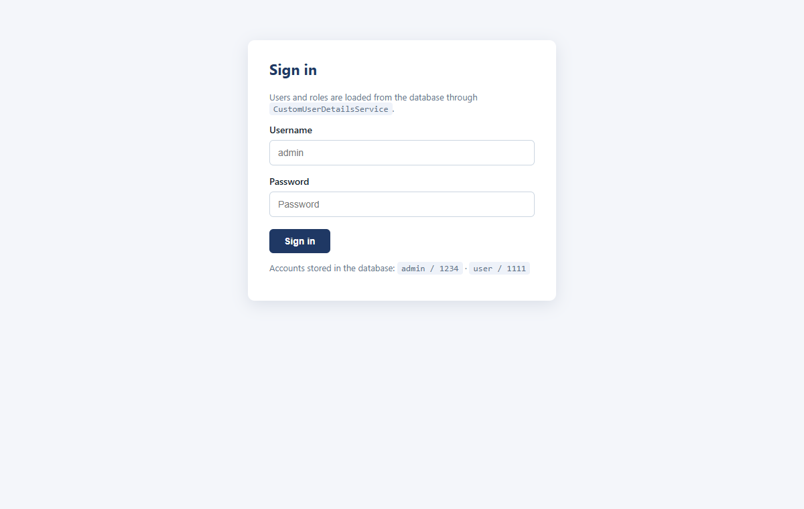
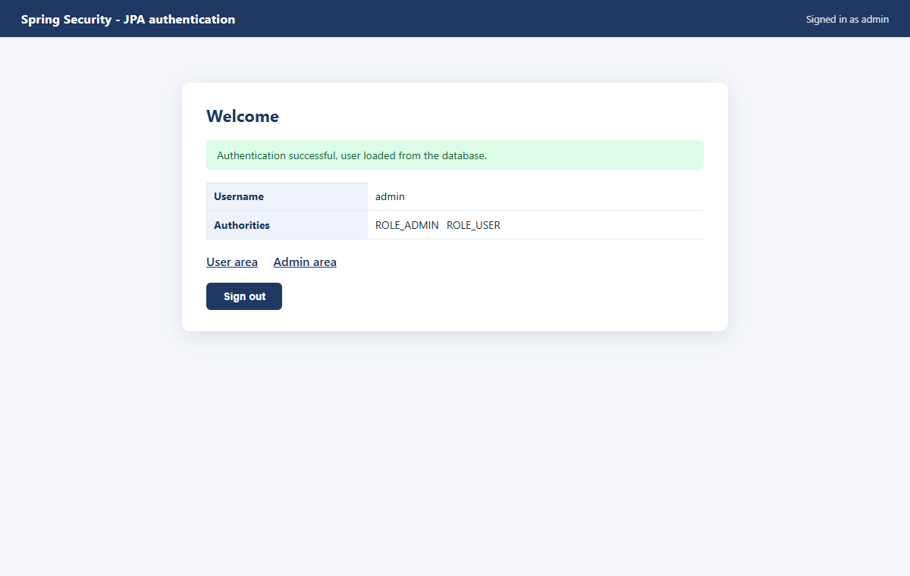
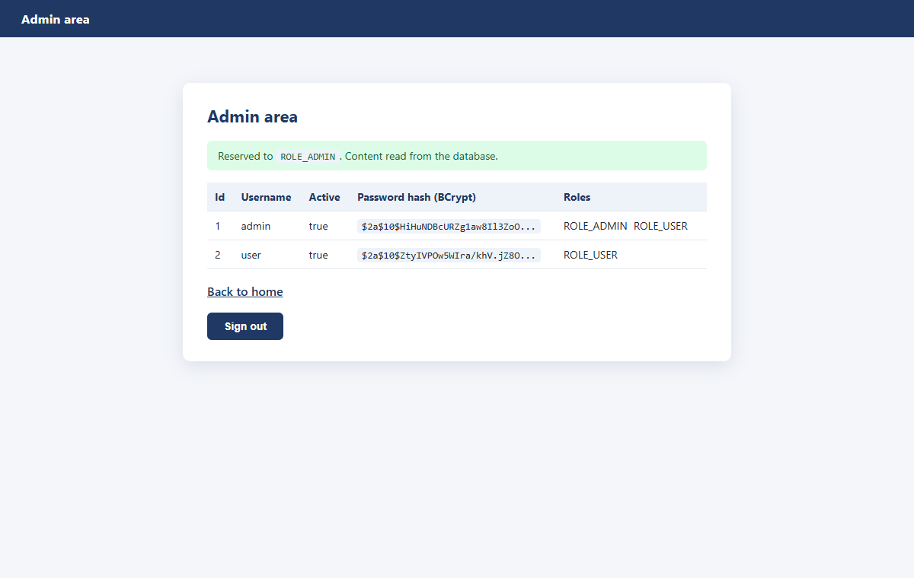

# J2E-Spring-TP11 — Authentification JDBC / JPA

TP 11 du cours *Développement JakartaEE : Spring* — authentification depuis une base MySQL avec entités `User` / `Role` et `CustomUserDetailsService`.



## Stack

`Java 17` · `Spring Boot 3.3` · `Spring Security` · `Spring Data JPA` · `MySQL` · `BCrypt` · `Lombok`

## Lancer

```bash
CREATE DATABASE security_db;

mvn spring-boot:run   # http://localhost:8083
mvn test              # tests sur H2 en mémoire
```

Comptes insérés au démarrage : `admin / 1234` (ADMIN+USER) · `user / 1111` (USER)

## Modèle de données

```
users            roles            user_roles
-----            -----            ----------
id               id               user_id (FK)
username (uniq)  name             role_id (FK)
password         (ROLE_ADMIN…)
active
```

`@ManyToMany(fetch = EAGER)` — les rôles sont chargés avec l'utilisateur, nécessaire pour Spring Security.

## Architecture

```
entities/      User, Role
repositories/  UserRepository, RoleRepository
services/      CustomUserDetailsService  (base → UserDetails + GrantedAuthority)
config/        SecurityConfig (DaoAuthenticationProvider + BCrypt), DatabaseInitializer
web/           HomeController
```





## Tests

**8/8** — `JpaAuthenticationTest` : persistance des rôles liés, hash BCrypt en base, mapping rôle → authority, `UsernameNotFoundException`, login réel, 403 avec ROLE_USER, flag `active`.

Auteur : [zAK4-7](https://github.com/zAK4-7)
